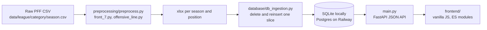
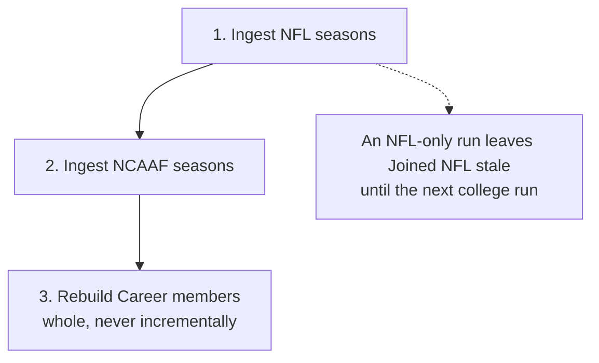
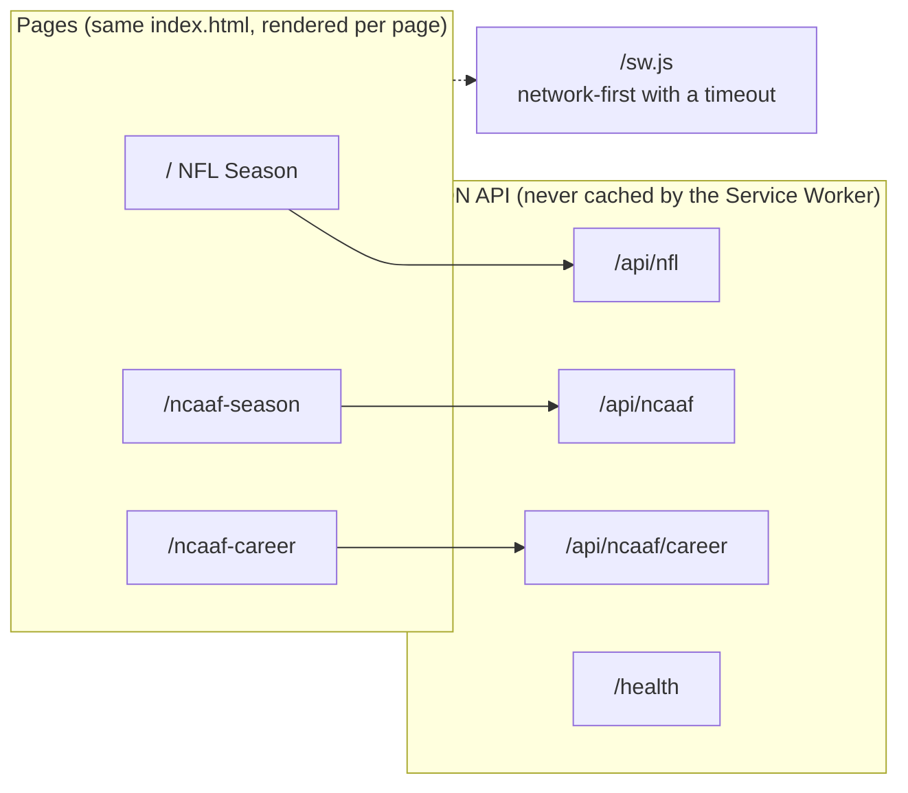
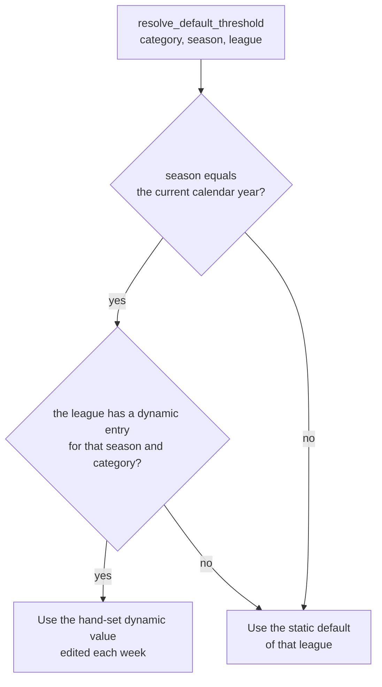
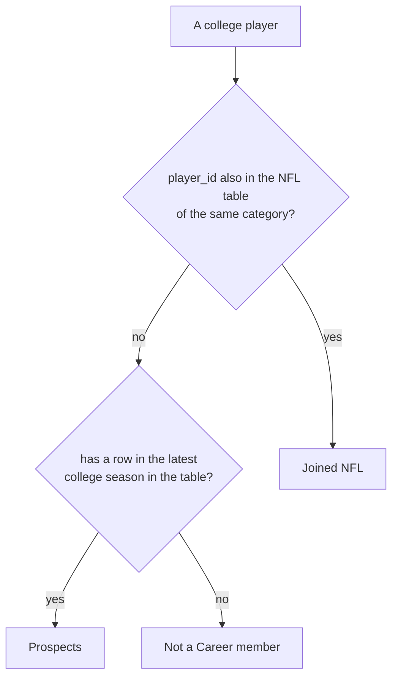
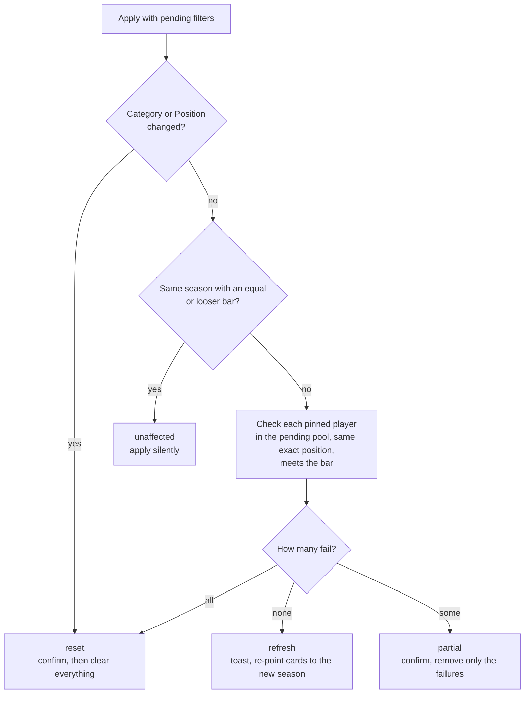
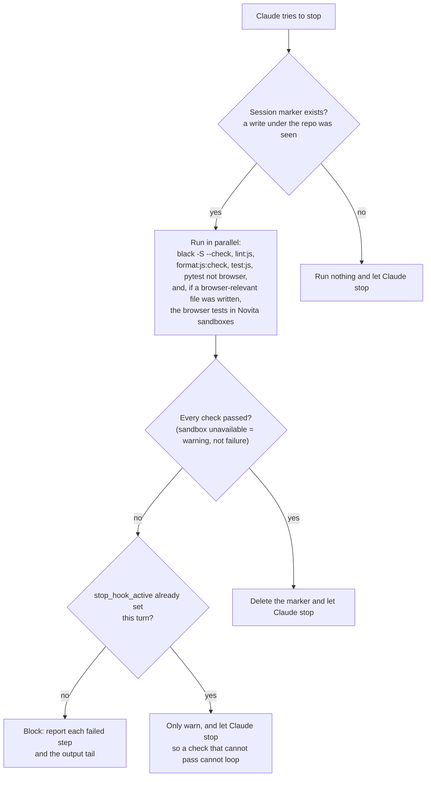

# Diagrams

> **Load when:** you need the shape of the system at a glance (data flow, routes, threshold routing, Career membership, pinned-impact outcomes, the Claude Code gate), or you add, change or remove a diagram.
> Every diagram here restates text that lives in another `architecture/` file, named under it. The text and the code win: if a diagram disagrees with them, fix the diagram in the same change.
> GitHub renders the Mermaid blocks. Keep node labels in double quotes and free of `<`, `>` and `|`, so every renderer accepts them.

## Data pipeline

Detail: `BACKEND-AND-DEPLOY.md`. Raw PFF files stay on the owner's machine (INVARIANT 13).

## Ingestion order

Detail: `BACKEND-AND-DEPLOY.md`, "Career members". The college run rebuilds the Career members by comparing with the NFL tables, so the NFL run goes first when both run.

## Pages and routes

Detail: `PWA.md`, `BACKEND-AND-DEPLOY.md`. `/` is always the NFL Season page and the PWA `start_url` stays `/` (INVARIANT 8).

## Threshold routing

Detail: `THRESHOLDS.md`. Routing compares calendar years, not the schedule. The threshold only gates the display (INVARIANT 5).

## Career membership

Detail: `BACKEND-AND-DEPLOY.md`, `database/career.py`. The two statuses never overlap. On the Career page each player must clear the bar of his own status.

## Pinned-impact outcomes

Detail: `PINNED-INVALIDATION.md`, `pinned-impact.js` (INVARIANTS 9 and 17). Judged once, on the final filter combination, when Apply is pressed.

A `partial` outcome also decides each Comparison: two or more members left means it shrinks, fewer than two means it dissolves.

## Claude Code Stop gate

Detail: `CLAUDE-HOOKS.md`. The gate is for local Claude Code sessions; GitHub Actions runs the full set on every push either way.

